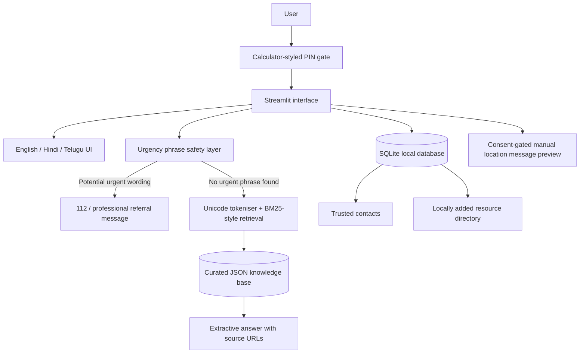

# AlnonAI 2.0 architecture

## Implemented prototype architecture



## Current implementation

- **UI:** Streamlit single-process application with pages for home, assistant, health literacy, support directory, safety, family wellbeing, practical support and privacy.
- **PIN gate:** random-salt PBKDF2-HMAC-SHA256 verifier. The PIN gates the app interface; it does not encrypt the SQLite database or provide multi-user authentication.
- **RAG:** Unicode tokenisation and a BM25-style lexical ranker over curated JSON chunks. Responses are assembled from retrieved passages and include their source links. A no-match result is returned when retrieval finds no evidence. No external LLM API is called.
- **Safety:** separate phrase matcher for English, Hindi and Telugu. A match triggers an immediate emergency referral message. This is not clinical triage and may miss emergencies.
- **Persistence:** SQLite stores resource entries, trusted contacts and settings. Chat, appointment notes and the safety checklist remain session-only.
- **Location:** no GPS or background location. A user may type an approximate location, explicitly consent and manually share a preview; nothing is transmitted automatically.

## Knowledge chunk schema

Each JSON record contains:

```json
{
  "id": "who-alcohol-en",
  "language": "English",
  "topic": "health",
  "title": "WHO: Alcohol and health",
  "text": "A concise, reviewed passage...",
  "source_name": "World Health Organization",
  "source_url": "https://www.who.int/news-room/fact-sheets/detail/alcohol",
  "reviewed": "2026-11-12"
}
```

## Resource record schema

`resources` stores `name`, `category`, `description`, `city`, `state`, `country`, `phone`, `website`, `source_url`, `verified`, and `created_at`. User-added entries default to `verified=0`. The app requires a source URL and validates that source and website URLs use HTTP or HTTPS.

## Future production architecture

A production system should separate the mobile/web client, identity service, API, retrieval service, verified knowledge store and service directory. Use per-user authorisation, encrypted storage and transport, retention/deletion controls, audit logs, rate limits and consent receipts. A generative model may be added only behind a strict retrieval-grounding and safety layer, with explicit consent before external processing and no ability to override emergency referrals.

## Future evaluation

- Retrieval: precision@k, recall@k, citation correctness and no-answer accuracy.
- Safety phrase layer: sensitivity and false-negative review against clinician-authored test cases; false-positive review to avoid alarm fatigue.
- Language: fluent Hindi and Telugu human review, including medical terminology and emergency phrasing.
- Accessibility: keyboard-only use, screen-reader labels, contrast, zoom/text scaling and plain-language testing.
- Security: threat model, PIN brute-force review, database protection, dependency scan and independent penetration test.
